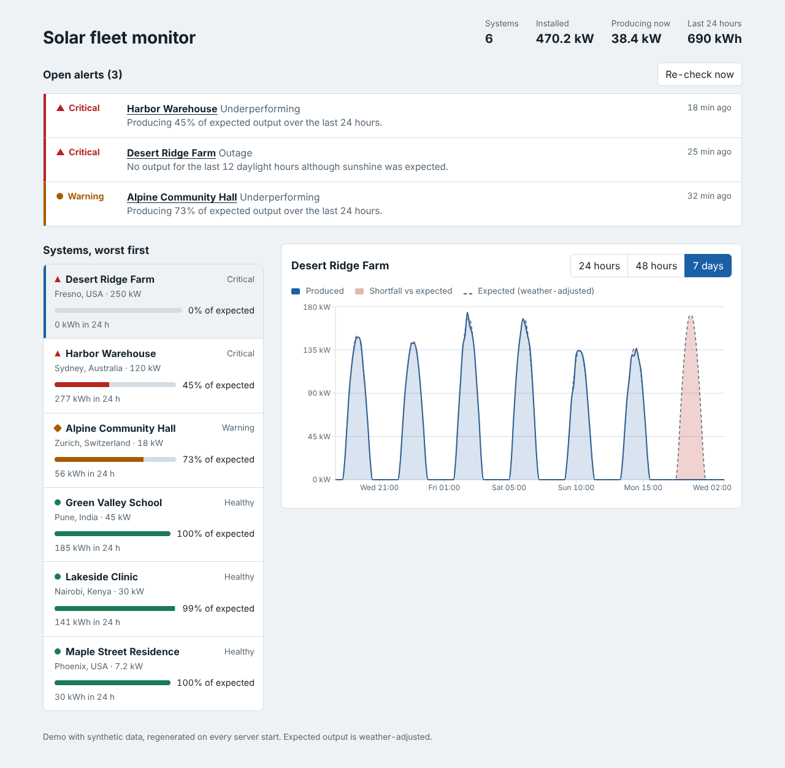

# Solar Fleet Monitor

[](https://github.com/yakshi0046/solar-energy-dashboard/actions/workflows/ci.yml)

A full-stack dashboard for monitoring a fleet of solar systems: hourly production against weather-adjusted expectation, a performance ratio per system, and automatic alerts when a system underperforms or stops producing.

**Live demo:** https://YOUR-APP.vercel.app (the API runs on free hosting, so the first load can take about a minute)



## What it does

- Generates seven days of synthetic hourly data for six systems in different time zones (sun curve, seasonality, daily cloudiness, sensor noise).
- Computes each system's **performance ratio**: energy produced over the last 24 hours divided by what the weather conditions should have yielded.
- Raises alerts with clear rules:

| Alert | Rule | Severity |
|---|---|---|
| Underperforming | Output is under 80% of expected over 24 h | Warning |
| Underperforming | Output is under 50% of expected over 24 h | Critical |
| Outage | The 3 most recent daylight hours produced almost nothing | Critical |

- Night hours are ignored, so a system is never flagged for not producing in the dark.
- Alerts open, update and resolve on their own when the data changes (**Re-check now** triggers an evaluation).
- The chart shades the **shortfall** between expected and produced output, in the system's own time zone.

Three of the six seeded systems have deliberate faults (a degraded array, an outage, mild underperformance), so the dashboard always has something to show.

## Architecture

```
React + TypeScript (Vite, Recharts)  --HTTP/JSON-->  Spring Boot 3 REST API  -->  H2 (in-memory)
                                                       |-- AlertRules    (pure logic, unit tested)
                                                       |-- SyntheticData (deterministic generator)
                                                       `-- AlertService  (opens / updates / resolves alerts)
```

| Layer | Choices |
|---|---|
| Backend | Java 17, Spring Boot 3.5, Spring Data JPA, H2, Actuator health check |
| Frontend | React 18, TypeScript, Vite, Recharts, plain CSS with light and dark themes |
| Tests | JUnit 5 for the alert rules and data generator, MockMvc smoke tests for the API |
| CI | GitHub Actions: `mvn verify` and the frontend type-check and build |

### API

| Method and path | Returns |
|---|---|
| `GET /api/summary` | Fleet totals: capacity, current power, 24 h energy, open alerts |
| `GET /api/systems` | Every system with its 24 h energy, performance ratio and status |
| `GET /api/systems/{id}/readings?hours=48` | Hourly `powerKw` and `expectedKw` (1 to 168 hours) |
| `GET /api/alerts?status=open` | Open alerts (`status=all` includes resolved) |
| `POST /api/alerts/evaluate` | Re-runs the alert rules and returns the number of changes |
| `GET /actuator/health` | Health check |

## Run locally

Requirements: JDK 17+, Maven 3.9+, Node 20+.

```bash
# terminal 1: API on http://localhost:8080
cd backend
mvn spring-boot:run

# terminal 2: UI on http://localhost:5173 (Vite proxies /api to the backend)
cd frontend
npm install
npm run dev
```

Run the tests with `cd backend && mvn test`.

## Deploy

1. **API on Render.** New > Web Service > connect this repo > Runtime **Docker** > Root directory `backend` > Instance type Free. Set the environment variable `CORS_ALLOWED_ORIGINS` to your frontend URL (no trailing slash, no spaces). Set the health check path to `/actuator/health`.
2. **UI on Vercel.** Import the repo > Root directory `frontend` > Framework Vite (detected automatically). Add the environment variable `VITE_API_URL` with your Render URL (no trailing slash).
3. Redeploy the API once the UI URL is known so the CORS setting takes effect.

Netlify works too: set the base directory to `frontend` and add `VITE_API_URL`.

## Design decisions

- **Expected output is weather-adjusted.** A healthy system on a cloudy day is not a problem, so expectation includes the day's irradiance and faults only affect the produced output. In production this would come from irradiance sensors or a weather API.
- **Alert rules are pure functions** over simple samples, separate from persistence, so they are easy to test. A test checks that the seeded faults are detected at every start hour across several dates.
- **Alerts have a lifecycle.** Re-evaluation updates an open alert, leaves it alone, or resolves it, so repeated checks never create duplicates.
- **H2 in memory** keeps the demo zero-config. Data is regenerated at every start so timestamps always end "now".

## Limitations and next steps

- Data is synthetic and regenerated on restart. Swap H2 for PostgreSQL and add an ingestion endpoint to use real readings.
- Alerts are evaluated on demand and at startup. A scheduled job would keep them current.
- No authentication. A real deployment would need it, along with per-tenant data.

## License

MIT
